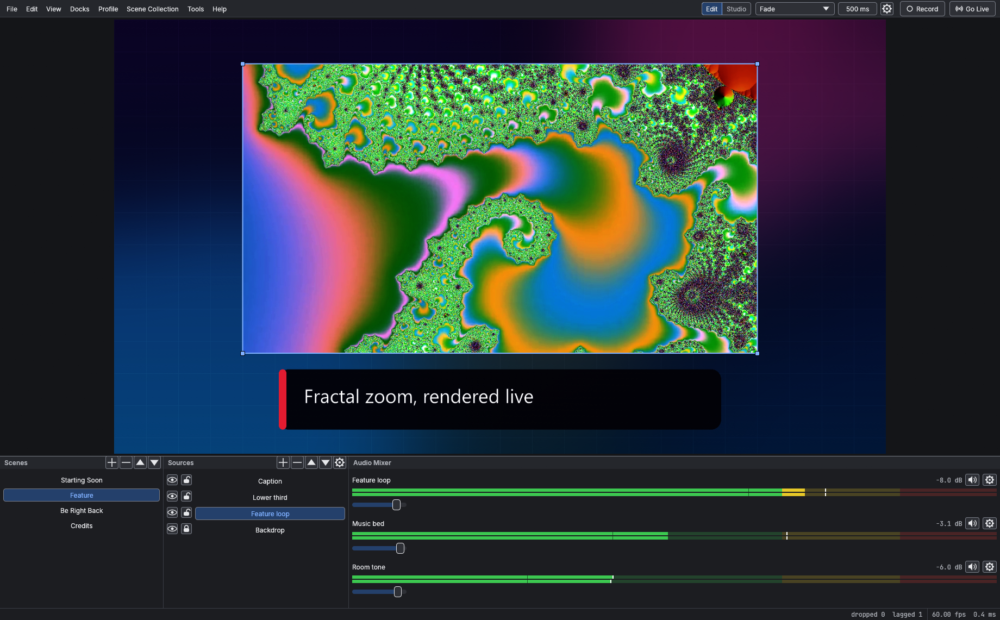
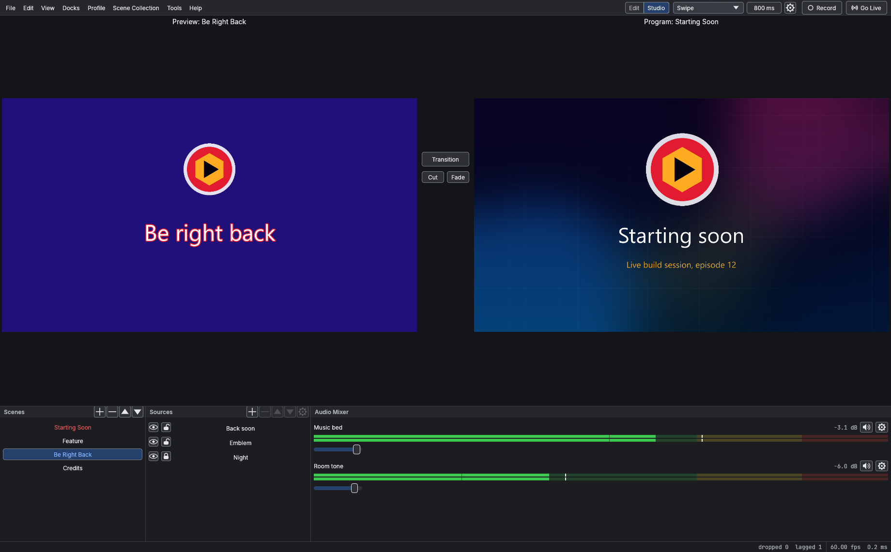
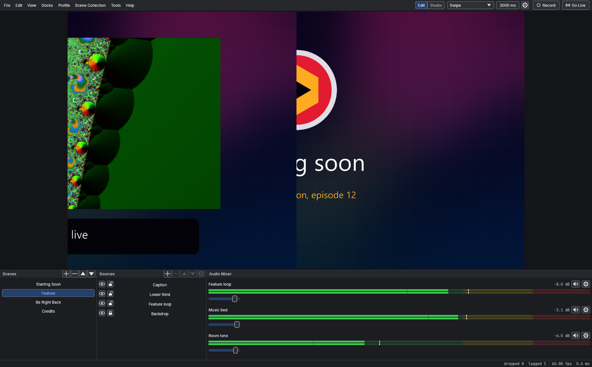
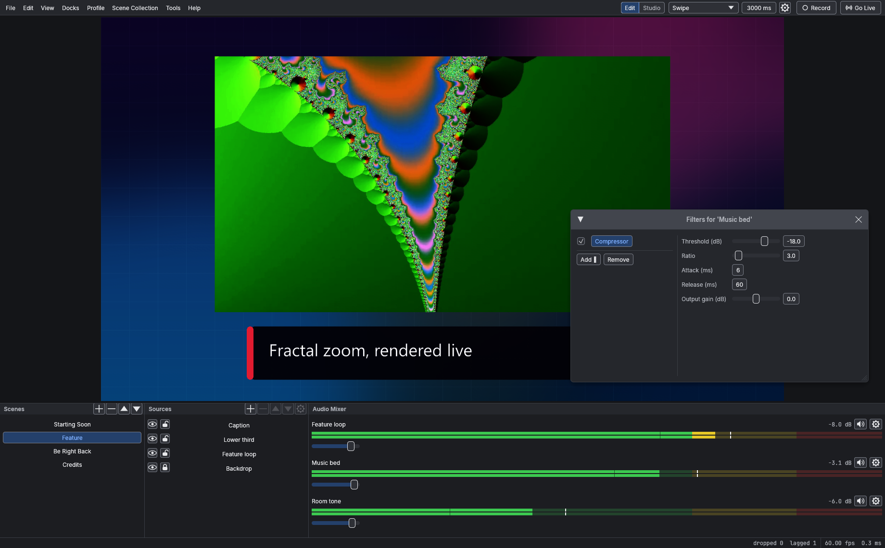
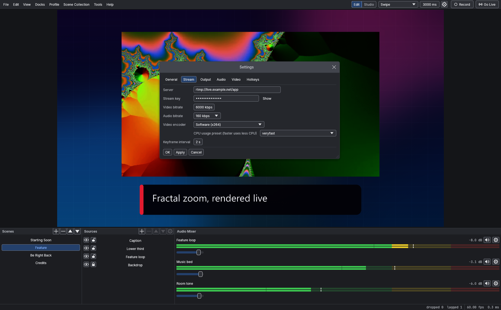
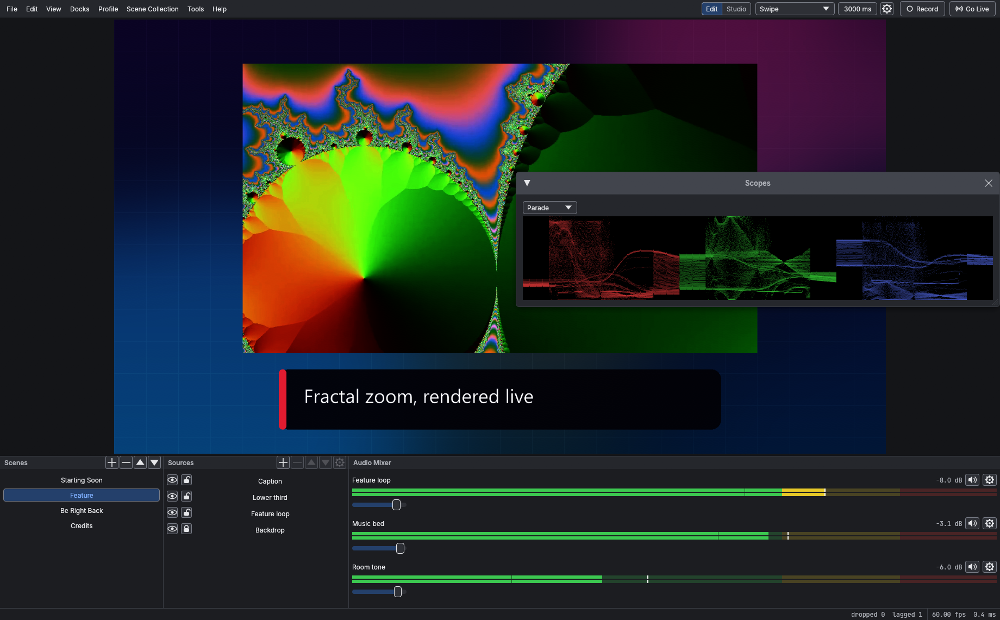

<p align="center">
  
</p>

<h1 align="center">StudioCraft</h1>

<p align="center">
  <b>Record and live-stream scenes with an open-source studio app written in Rust.</b>
</p>

<p align="center">
  
  
  
  
  <a href="https://github.com/blamejs/StudioCraft/releases"></a>
  <br>
  <a href="https://github.com/blamejs/StudioCraft/actions/workflows/ci.yml"></a>
  <a href="https://github.com/blamejs/StudioCraft/actions/workflows/github-code-scanning/codeql"></a>
  <a href="https://socket.dev"></a>
</p>

<br>

<p align="center">
  
  <br><sub><b>The main window</b>: the preview above, and the Scenes, Sources and Audio Mixer docks below</sub>
</p>

<p align="center">
  <a href="#a-look-around">A look around</a> ·
  <a href="#download-and-install">Download</a> ·
  <a href="#quick-start">Quick start</a> ·
  <a href="#features-at-a-glance">Features</a> ·
  <a href="#documentation">Documentation</a> ·
  <a href="#building-from-source">Building from source</a> ·
  <a href="#license">License</a>
</p>

StudioCraft records and live-streams scenes. A scene is a stack of sources: displays, windows,
cameras, pictures, text, colors, media files and audio devices. You arrange the sources on a
canvas, switch between scenes with transitions, mix the audio, and record to a file or stream to a
Real-Time Messaging Protocol (RTMP) server.

StudioCraft is written in Rust and draws its window with egui and wgpu. It runs on Windows, macOS
and Linux.

## A look around

<table>
<tr>
<td width="50%" valign="top">
  
  <p align="center"><sub><b>Studio mode</b>: edit the next scene beside the live one, then send it to the program</sub></p>
</td>
<td width="50%" valign="top">
  
  <p align="center"><sub><b>Transitions</b>: cut, fade, fade through a color or swipe, with easing</sub></p>
</td>
</tr>
<tr>
<td width="50%" valign="top">
  
  <p align="center"><sub><b>Audio Mixer and filters</b>: meters, faders and a compressor on a music bed</sub></p>
</td>
<td width="50%" valign="top">
  
  <p align="center"><sub><b>Settings</b>: General, Stream, Output, Audio, Video and Hotkeys tabs</sub></p>
</td>
</tr>
<tr>
<td colspan="2" valign="top">
  
  <p align="center"><sub><b>Scopes</b>: a waveform, an RGB parade, a histogram, or a YUV or HLS vectorscope of the program</sub></p>
</td>
</tr>
</table>

## Download and install

Download the file for your system from the
[Releases page](https://github.com/blamejs/StudioCraft/releases): an `.msi` or portable `.zip` for
Windows, a `.dmg` for macOS, or an `.AppImage`, `.deb`, `.rpm`, `.flatpak` or `.tar.gz` for Linux.
[Getting started](https://github.com/blamejs/StudioCraft/blob/main/docs/getting-started.md#install-from-a-release)
explains which file to pick.

## Quick start

A new scene collection already has two audio sources, Desktop audio and Microphone, which every
scene records. Desktop audio captures the sound the computer plays on Windows and Linux. To leave
one out, mute it in the Audio Mixer dock.

To make a first recording, which does not need `ffmpeg`:

1. In the Sources dock, click + and add a Display capture source. On macOS, allow StudioCraft in
   System Settings › Privacy & Security › Screen Recording when the system asks.
2. Open the Settings window: Edit › Preferences… on Windows and Linux, or StudioCraft › Settings…
   (⌘,) on macOS. In the Output tab, set Video encoder to H.264 (built in) and keep Format at MKV.
3. Click Record, and click it again to stop. The file goes to your Videos folder.

To stream, install `ffmpeg` on the `PATH` (or set its location in Settings › Output), enter the
Server and Stream key in Settings › Stream, and click Go Live. Streaming, and recording with an
encoder other than H.264 (built in), need `ffmpeg`.

## Features at a glance

- [Sources](https://github.com/blamejs/StudioCraft/blob/main/docs/features.md#sources) capture
  displays, windows, cameras, pictures, text, colors, media files and audio devices.
- [Filters](https://github.com/blamejs/StudioCraft/blob/main/docs/features.md#filters) correct
  color, key, crop, mask, scroll and sharpen the picture, and shape the sound.
- [Transitions](https://github.com/blamejs/StudioCraft/blob/main/docs/features.md#transitions)
  cut, fade, fade through a color or swipe between scenes, and studio mode previews the next scene.
- The [audio mixer](https://github.com/blamejs/StudioCraft/blob/main/docs/features.md#audio) has
  meters, faders, sync offsets and monitoring.
- [Recording](https://github.com/blamejs/StudioCraft/blob/main/docs/features.md#recording) writes
  MKV, MP4 and MOV files, and the replay buffer saves the last seconds on demand.
- [Streaming](https://github.com/blamejs/StudioCraft/blob/main/docs/features.md#streaming) sends
  the program to an RTMP server at a constant bitrate.
- [Hardware acceleration](https://github.com/blamejs/StudioCraft/blob/main/docs/features.md#hardware-acceleration)
  picks the graphics adapter and the hardware encoder.
- The [interface](https://github.com/blamejs/StudioCraft/blob/main/docs/features.md#interface) has
  a compact theme, movable docks, nineteen languages and update checks.
- [Hotkeys](https://github.com/blamejs/StudioCraft/blob/main/docs/features.md#hotkeys) can be set
  for every command that takes a shortcut.
- [Settings](https://github.com/blamejs/StudioCraft/blob/main/docs/features.md#settings) has
  General, Stream, Output, Audio, Video and Hotkeys tabs.
- [Control and automation](https://github.com/blamejs/StudioCraft/blob/main/docs/features.md#control-and-automation)
  covers the control channel, the command-line tool and the Model Context Protocol (MCP) server.

## Documentation

The Windows portable `.zip`, the macOS command-line `.zip` and the Linux packages include this
README without the `docs/` folder, so the links below go to the repository on GitHub.
[docs/README.md](https://github.com/blamejs/StudioCraft/blob/main/docs/README.md) lists every page
by reader.

- Use the app:
  [Getting started](https://github.com/blamejs/StudioCraft/blob/main/docs/getting-started.md),
  [Features](https://github.com/blamejs/StudioCraft/blob/main/docs/features.md) and
  [Troubleshooting](https://github.com/blamejs/StudioCraft/blob/main/docs/troubleshooting.md).
- Control and automate it:
  [Control protocol](https://github.com/blamejs/StudioCraft/blob/main/docs/control-protocol.md) and
  [MCP server](https://github.com/blamejs/StudioCraft/blob/main/docs/mcp.md).
- Contribute: [AGENTS.md](https://github.com/blamejs/StudioCraft/blob/main/AGENTS.md),
  [Architecture](https://github.com/blamejs/StudioCraft/blob/main/docs/architecture.md),
  [Performance](https://github.com/blamejs/StudioCraft/blob/main/docs/performance.md),
  [MECHANICS.md](https://github.com/blamejs/StudioCraft/blob/main/MECHANICS.md),
  [ASSETS.md](https://github.com/blamejs/StudioCraft/blob/main/ASSETS.md) and
  [ROADMAP.md](https://github.com/blamejs/StudioCraft/blob/main/ROADMAP.md).
- Release: [Releasing](https://github.com/blamejs/StudioCraft/blob/main/docs/releasing.md).

## Building from source

You need a Rust toolchain that supports edition 2024 and, on Linux, the development packages for
X11, Wayland, fontconfig, ALSA and PipeWire (`libpipewire-0.3-dev` on Debian and Ubuntu), and
libclang. To build and run the app, run:

```sh
cargo run --release
```

Every build includes Inter and JetBrains Mono from `assets/fonts`, which cover Latin, Greek and
Cyrillic text. To build in the faces for other scripts (Arabic, Chinese, Japanese, Korean, Thai and
more), point `CRAFT_FONTS_DIR` at a checkout of
[craft-fonts](https://github.com/storytold/craft-fonts):

```sh
CRAFT_FONTS_DIR=/path/to/craft-fonts cargo run --release
```

StudioCraft's own translation catalogs are in `crates/ui-egui/i18n/locales/<locale>/studiocraft.tsv`,
in craft-i18n's catalog format, and every build includes them. `en/studiocraft.tsv` lists the
English source text of every interface string, and a test fails when the window looks up a string
that has no row there. Every locale with a `studiocraft.tsv` is listed in Settings › General ›
Language.

To add the catalogs the Craft apps share, point `CRAFT_I18N_DIR` at a checkout of
[craft-i18n](https://github.com/storytold/craft-i18n) (Apache-2.0). Its `common.tsv` files are
added, and so is any `studiocraft.tsv` it has. Where both catalogs have a row for the same text,
the row in this repository is used. Both paths must be absolute.

```sh
CRAFT_I18N_DIR=/path/to/craft-i18n CRAFT_FONTS_DIR=/path/to/craft-fonts cargo run --release
```

Before a commit, run `cargo xtask ci`. It runs these checks in order and stops at the first
failure:

1. `cargo fmt --all --check`.
2. Clippy on the workspace with warnings as errors.
3. The tests (`cargo test --workspace`).
4. The crate layer check.
5. The dependency license check.
6. The `unsafe` check, which allows `unsafe` only in the native hardware crates.
7. The asset list check against `ASSETS.md`.
8. The product name check.
9. The WebAssembly build (`cargo check --target wasm32-unknown-unknown`) of the crates that build
   for the web, which [docs/architecture.md](https://github.com/blamejs/StudioCraft/blob/main/docs/architecture.md)
   lists.

`cargo xtask help` lists each check as its own command.
[AGENTS.md](https://github.com/blamejs/StudioCraft/blob/main/AGENTS.md#4-before-every-commit) has
the rules every change follows.

## License

StudioCraft is licensed under either of [Apache License, Version 2.0](LICENSE-APACHE) or
[MIT license](LICENSE-MIT) at your option.
